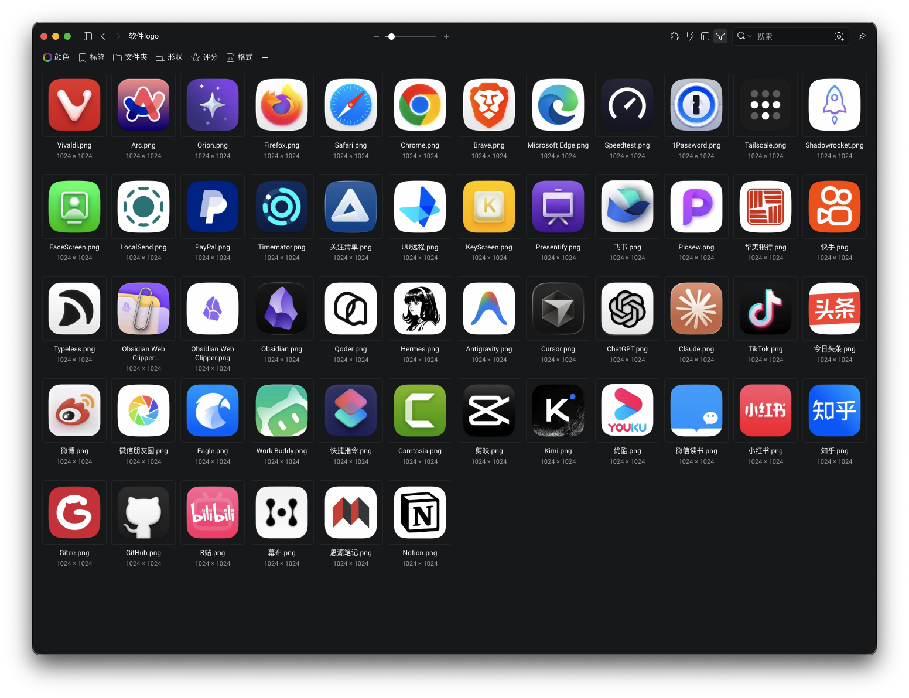

# zzm-applogo

告诉 AI「帮我下载 ChatGPT、Obsidian 和飞书的 App logo」，将应用图标保存到工作区。



图标效果示例。下载后的 PNG 文件保存到工作区或指定目录。

从 **苹果 App Store** 与 **[macosicons.com](https://macosicons.com/)** 查找图源，统一输出 **1024×1024 透明 PNG、圆角和柔和阴影**。支持单个下载、批量编号、候选预览及下载报告。

无需登录、API Key 或素材库软件。下载过程中不修改系统图标，不扫描本机应用。

## 安装 Skill

使用 [Skills CLI](https://skills.sh/docs/cli) 安装（需要 Node.js）：

```bash
npx skills add zhaozimin/zzm-applogo-skill
```

按提示选择自己的 AI Agent，安装 `zzm-applogo`。
也可以下载本仓库，把 **`zzm-applogo/` 整个目录**复制到 Agent 支持的 skills 目录。
这是标准 `SKILL.md` 目录，不要求使用某一种 Agent。

运行依赖是 **Python 3.10+、Pillow、NumPy**。请让 Agent 在独立虚拟环境中安装 `zzm-applogo/requirements.txt`，或按下方命令手动安装。

## 对 AI 这样说

```text
帮我下载 ChatGPT 的 app logo。
帮我下载 Obsidian、飞书、剪映的 logo，编号并生成预览图。
把微信 logo 下载到我指定的文件夹。
用 App Store 图源下载 Notion 的常规版图标。
先看看 macosicons 上 Notion 的 3 个暗黑款候选。
```

默认保存到当前工作区的 `app-logos/`。
用户指定目录时使用该目录。同名文件添加递增后缀，保留已有文件。

## 手动运行

先克隆仓库并进入目录：

```bash
git clone https://github.com/zhaozimin/zzm-applogo-skill.git
cd zzm-applogo-skill
python -m venv .venv
```

macOS / Linux：

```bash
.venv/bin/python -m pip install -r zzm-applogo/requirements.txt
.venv/bin/python zzm-applogo/scripts/downlogo.py download ChatGPT
.venv/bin/python zzm-applogo/scripts/downlogo.py download Obsidian 飞书 剪映 --numbered --preview -o ./app-logos
```

Windows PowerShell：

```powershell
.venv\Scripts\python.exe -m pip install -r zzm-applogo\requirements.txt
.venv\Scripts\python.exe zzm-applogo\scripts\downlogo.py download ChatGPT
```

若系统使用 `python3` 或 `py -3` 启动 Python，请相应替换创建虚拟环境的命令。

下列示例中的 `python` 指已安装依赖的解释器：

```bash
# 查找两个来源的候选，不下载图片
python zzm-applogo/scripts/downlogo.py search Notion

# 指定来源、地区与平台
python zzm-applogo/scripts/downlogo.py download 微信 --source appstore --country cn --platform ios
python zzm-applogo/scripts/downlogo.py download Cursor --source macosicons

# 同名应用：核对开发者后用商店 ID 指定
python zzm-applogo/scripts/downlogo.py download ChatGPT --app-id 6448311069

# 指定社区候选 ID；将 ICON_ID 替换为 search 返回的 id
python zzm-applogo/scripts/downlogo.py download Notion --source macosicons --id ICON_ID

# 暗黑、浅色、玻璃款式仅从社区图源选择
python zzm-applogo/scripts/downlogo.py download Notion --source macosicons --style dark --candidates 3 --preview

# 统一已有图片；再次运行会另存，保留旧文件
python zzm-applogo/scripts/downlogo.py normalize -i ./input.png -o ./app-logos/App.png
python zzm-applogo/scripts/downlogo.py verify ./app-logos/App.png
```

## 下载结果

```text
app-logos/
  01_ChatGPT.png
  02_Obsidian.png
  _预览汇总图.png
  download-report.json
```

报告记录来源、开发者或社区标记、原图大小、成品路径、规格结果与失败原因。
主图标和预览拼图分别交付，拼图不适用单图标规格。
标准输出是 JSON，进度写入标准错误。
批量任务逐项返回结果，存在失败或待选择项时退出码为 1。

## 来源与外观边界

- 默认优先 App Store 的常规图源，未匹配时由 macosicons 兜底；可指定只用一个来源。
- App Store 默认按 `cn,us` 查找，先 iOS，再 macOS。不同地区和平台的图案由来源决定。
- 同名或不确定的匹配会要求选择，不能仅凭上架或搜索排名认定品牌身份。
- macosicons 是社区图源；网站的官方标记不是 Apple 认证。默认排除改色、旧版和特殊款式。
- 飞书与 Lark、剪映与 CapCut 分开识别。
- 所有主图标统一外轮廓、阴影和画布；图案内部烘焙的光影保留。
- 低清原图会标记 `upscaled: true`，不将输出尺寸当作原生分辨率。
- 外观是固定排版样式，不是某一版 iPhone 系统效果的逐像素复刻。[Apple 说明](https://developer.apple.com/documentation/xcode/creating-your-app-icon-using-icon-composer)
- 搜索接口或 CDN 发生变化时，报告失败；网络故障与无搜索结果分开记录。

完整参数与来源说明见 [图标规格](zzm-applogo/references/icon-spec.md)。

## 开发与验证

```bash
python -m unittest discover -s tests -v
```

离线测试覆盖应用匹配、来源失败、圆角阴影、ICNS 解码、批量部分失败和文件防覆盖。
GitHub Actions 在 Linux、Windows、macOS 上验证 Python 3.10 与 3.13。
在线图源可用性需要另外运行真实下载，离线测试不承诺源站持续在线。

## 许可

[MIT](LICENSE) 许可覆盖代码与说明，不授予下载图标的版权或商标权。
图标的使用须遵守品牌方、作者和来源网站的条件。[Apple 素材使用条件](https://performance-partners.apple.com/search-api)
